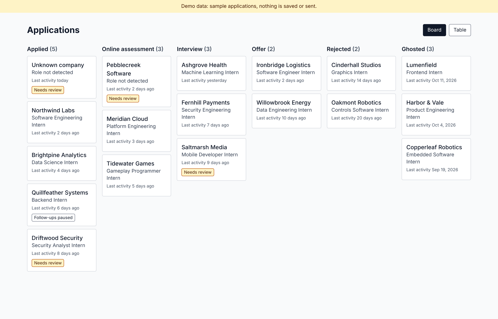
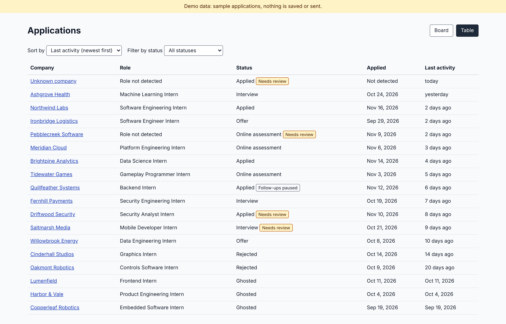
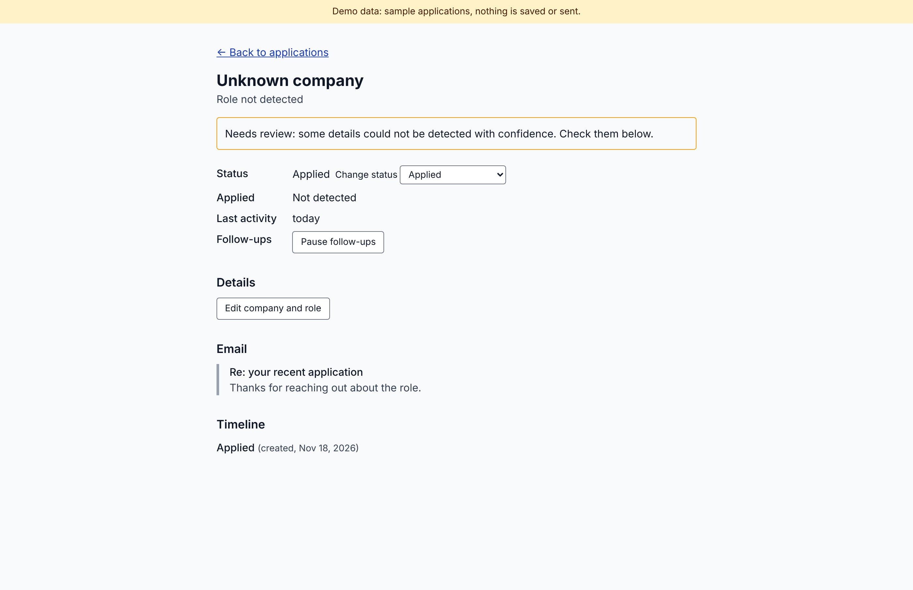
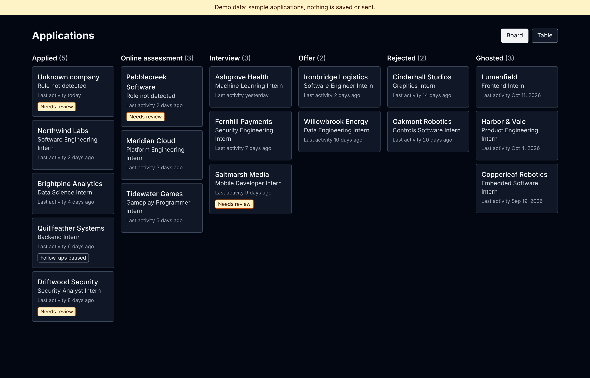
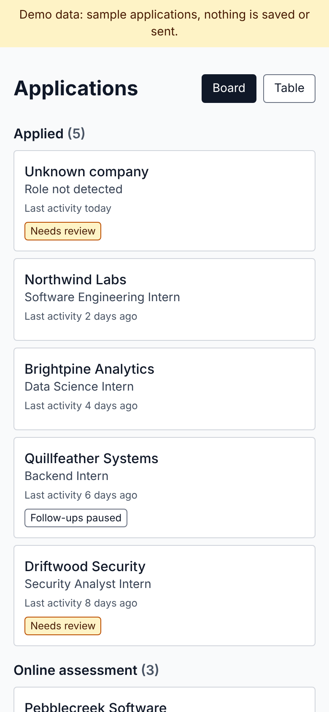
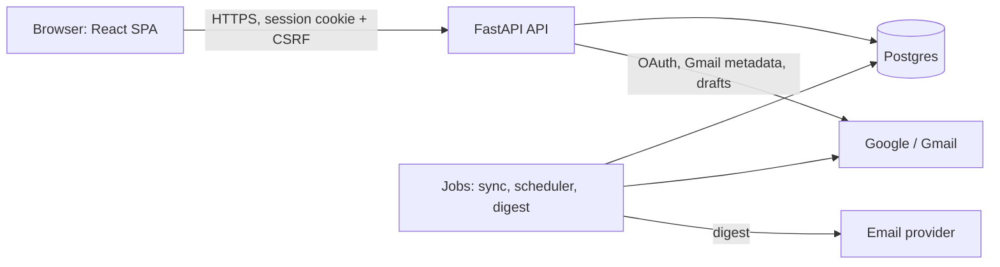

# Application Tracker

[](https://github.com/Aliankhann/ApplicationTrackerAI/actions/workflows/ci.yml)
[](https://github.com/Aliankhann/ApplicationTrackerAI/actions/workflows/security.yml)
[](LICENSE)

Connect Gmail and see every internship application with its status, get follow-up drafts in the
right thread, and a short daily digest, without the app ever storing your email bodies.

> **Status:** feature-complete for v1 in code and tested end to end against fakes of Google and
> Gmail. Not deployed yet: the live demo link, Google project, and hosting are the remaining launch
> steps (see [Roadmap](#roadmap)). Built for a small invited group, up to 100 users.

**Demo:** run it locally (`pnpm dev`, then open `/demo`). A hosted demo link will go here once
staging is deployed. The demo uses synthetic data and makes no network calls.

## Screenshots

| Board | Table |
| --- | --- |
|  |  |

| Application detail | Dark mode | Mobile |
| --- | --- | --- |
|  |  |  |

## Features

- **Automatic tracking.** A 90-day initial sync, then hourly incremental sync from Gmail history.
  Non-job email is discarded before anything is stored.
- **Status board.** Applied, online assessment, interview, offer, rejected, and a derived
  "ghosted" column; a sortable table view; a timeline per application; manual status fixes that
  the classifier never overrides.
- **Careful classification.** Ordered rules tuned for precision (a wrong "rejection" is the
  costliest error) with anything unsure marked "needs review", measured on a held-out eval set in
  CI.
- **Follow-up drafts.** Configurable sequences (default day 7 and day 14) create reply drafts in
  the original Gmail thread on weekday mornings in your timezone. They stop on any reply. Drafts
  only: nothing is ever sent.
- **Daily digest.** One short email at 8:00 local time with company names and statuses only, and
  one-click unsubscribe.
- **Your data, your call.** Disconnect Gmail or delete everything in one step. A public
  [privacy page](frontend/src/pages/PrivacyPage.tsx) states exactly what is read and stored.
- **Invite-only.** Single-use invite codes plus an allowlist protect Google's 100-user lifetime
  cap for unverified apps.

## Architecture



The browser only talks to the API; the API and scheduled jobs are the only code that touches
Gmail, email, and the database. Details: [architecture](docs/architecture.md),
[threat model](docs/threat-model.md), and [decision records](docs/decisions/README.md).

## Security highlights

- **Minimal data.** Thread metadata and a 200-character snippet only; no bodies, no recipient
  addresses. Gmail is read with `format=metadata`.
- **Encrypted tokens.** Refresh tokens are AES-256-GCM encrypted, with versioned keys outside the
  database and a rotation command.
- **Isolation tested.** Every query is scoped by user, and a route-walking test proves user B
  can't read or change user A's data on any route, including routes added later.
- **Web defenses.** Server-side sessions, `__Host-` cookies, CSRF enforced on every write by
  default, strict CSP and security headers, rate limits, and allowlisted structured logs that
  never contain email content or tokens.
- **Drafts first.** The Gmail client has no send operation. A per-user lease and a per-task claim
  prevent duplicate drafts, even under concurrency or crashes.
- **Delete means delete.** A metadata-driven test asserts zero rows remain in every table after
  account deletion.

## Tech stack

- **Backend:** Python 3.13, FastAPI, SQLAlchemy 2, Alembic, Postgres, httpx, PyJWT, managed with uv
- **Frontend:** React, TypeScript, Vite, React Router, TanStack Query, Tailwind, Zod, with a typed
  client generated from OpenAPI
- **Testing:** pytest and Hypothesis (property tests with a fake clock), Vitest and Testing
  Library, Playwright with axe accessibility checks
- **Tooling:** ruff, mypy (strict), oxlint, pre-commit with gitleaks, GitHub Actions, CodeQL,
  pip-audit, Dependabot

## Repo layout

```text
backend/    FastAPI app, jobs, tests, Alembic migrations, classifier eval
frontend/   React app, unit tests, Playwright e2e tests
docs/       build plan, backlog, architecture, threat model, decision records, screenshots
infra/      Dockerfiles and local docker-compose
.github/    CI, security scans, Dependabot, templates
```

## Quick start

Prerequisites: [uv](https://docs.astral.sh/uv/), Node 22 with pnpm, Docker.

```bash
# 1. Database
docker compose -f infra/docker-compose.yml up -d

# 2. Backend (http://localhost:8000, docs at /docs)
cd backend
cp .env.example .env
uv sync
uv run alembic upgrade head
uv run uvicorn app.main:app --reload

# 3. Frontend (http://localhost:5173, demo at /demo)
cd frontend
cp .env.example .env.local
pnpm install
pnpm dev
```

Without Google credentials, `/demo` works fully, and `uv run python -m app.cli session create
--email you@example.com` mints a local session for trying the signed-in pages.

Secret scanning before every commit:

```bash
uv tool install pre-commit && pre-commit install
```

## Checks

| | Backend (`backend/`) | Frontend (`frontend/`) |
| --- | --- | --- |
| Lint | `uv run ruff check .` | `pnpm lint` |
| Types | `uv run mypy app tests eval` | `pnpm typecheck` |
| Tests | `uv run pytest` | `pnpm test` |
| Classifier eval | `uv run python -m eval.run --split all` | |
| End to end | | `pnpm e2e` |

After changing an API route, run `pnpm gen:api` in `frontend/` to regenerate the typed client. CI
fails if it is stale.

## Roadmap

Work is tracked story by story in the [backlog](docs/backlog.md).

- **Launch steps (need the operator):** Google Cloud projects and consent screens, a host and
  staging deploy with scheduled jobs, branch protection, an email provider and domain (SPF, DKIM,
  DMARC), then production behind a manual approval.
- **v1 optional:** an LLM fallback for emails the rules can't decide, after a review of Google's
  Limited Use policy.
- **v1.1:** opt-in auto-send with caps and a notice window, CSV export, and growing beyond the
  first 10 users in batches.

## License

[MIT](LICENSE)
