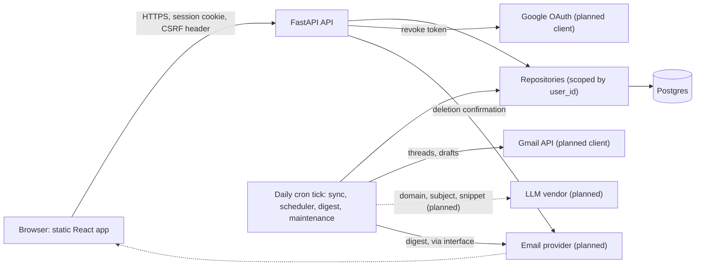
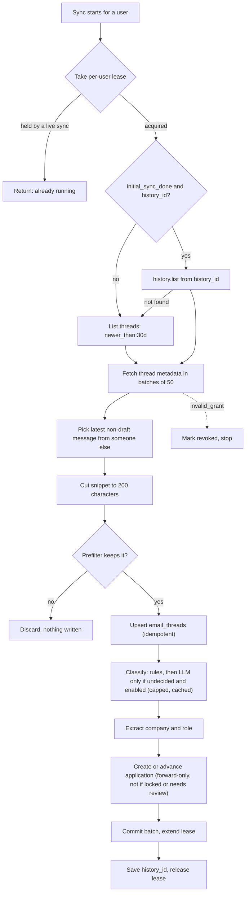

# Architecture

Status as of 2026-11-18. "Built" means code and tests exist today; "planned" names the backlog
story ([backlog.md](backlog.md)). Scope and roadmap are in [build-plan.md](build-plan.md). Security
detail is in [threat-model.md](threat-model.md); decisions are in [decisions/](decisions/README.md).

## Components

| Component | Where | State |
| --- | --- | --- |
| Static React app (Vercel project 1) | `frontend/` (React, TypeScript, Vite, TanStack Query) | Built: dashboard, detail, follow-ups, settings, privacy page, demo mode. Talks only to the API. Sign-in and invite pages are planned (US-15) |
| API (Vercel project 2, one Python function) | `backend/app/api`, `main.py`, `backend/api/index.py` (FastAPI) | Built: `/me`, `/auth/logout`, applications, follow-ups, sequences, settings, `/gmail/disconnect`, `/unsubscribe`, health. Sign-in (US-11), connect (US-31), and manual sync (US-34) are planned |
| Services | `backend/app/services` | Built: sync, prefilter, classification, extraction, applications, sequences, templates, follow-up policy, scheduler, digest, account |
| Providers | `backend/app/providers` | Interfaces and fakes for Gmail, the token revoker, the classifier, and the email sender. Real Gmail client and revoker: planned (US-31). LLM classifier (Claude fallback behind a router, off by default): built (US-45, US-46). Real email provider: planned (US-71) |
| Repositories | `backend/app/repositories` | Built: all user-scoped queries |
| Jobs | `backend/app/jobs` | `tick.py` is the single daily dispatcher (sync, follow-ups, digest, maintenance) behind `GET /internal/cron/tick`; `sync`, `scheduler`, `digest`, `maintenance` keep their `python -m app.jobs.*` entry points |
| Security helpers | `backend/app/security` | Built: token encryption, sessions, invite codes, unsubscribe tokens |
| CLI | `backend/app/cli.py` | Built: `invite create`, `invite list`, `invite revoke`, `tokens rotate`, local-only `session create` |
| Postgres | one database shared by API and jobs | Built; migrations in `backend/alembic/versions` |

Every outside call (Gmail, the LLM, the email provider) leaves from the backend, never the browser.

## Hosting on Vercel (Hobby)

See [ADR 0009](decisions/0009-hosting-on-vercel.md) and [deploy.md](deploy.md). Two Vercel projects per environment: the static frontend and the API as one Python function (`backend/api/index.py`, every path rewritten to it, `maxDuration` 300 s).

- **No background tasks.** Anything that must finish runs inside a request or the daily tick. "Sync now" runs inline with a 25 s budget.
- **One daily cron**, `GET /internal/cron/tick` at 12:00 UTC (`backend/vercel.json`, the only place to change the time). It requires `Authorization: Bearer <CRON_SECRET>`, needs no session, and is hidden from the OpenAPI schema. Order and share of the 240 s budget (20 s kept as margin): Gmail sync (up to 60%, oldest `last_synced_at` first, skipping users synced in the last 12 h), follow-up scheduler (to 85%), digest (to 100%), then the maintenance purge (once per UTC day, tracked in `job_runs`). Each part checks the budget before every user and stops cleanly; the log line `cron.tick` and the JSON response carry counts and `budget_exhausted` only.
- **Resumable sync.** Past the deadline a sync stops between batches, commits, frees its lease, and reports partial. The initial sync keeps its history id and Gmail list page token in `sync_state` and continues from that page at the next daily run or "Sync now"; `history_id` is stored only when it completes.
- **Database.** `DB_POOL_MODE=serverless` uses no app-side pool (`NullPool`) and no prepared statements, so a transaction-mode pooler URL works. The code keeps no session-level database state across transactions: locks are lease rows or transaction-level advisory locks.

## Request flow

1. The browser sends a request with the session cookie. For `POST`, `PATCH`, `PUT`, and `DELETE` it
   also sends `X-CSRF-Token`.
2. Middleware runs: security headers, request logging (route template, status, duration, request
   ID; no content), and an `Origin` check for state-changing requests ([middleware.py](../backend/app/middleware.py)).
   CORS allows only the app origin.
3. An app-wide dependency, `require_csrf`, rejects any non-safe request without a valid session and
   a matching header and cookie. Only the signed `/unsubscribe` routes are exempt
   ([deps.py](../backend/app/api/deps.py)).
4. The route resolves the current user from the server-side session, then calls a service or a
   repository. Repositories filter by `user_id`; an ID belonging to someone else is a 404.
5. The route returns JSON. The OpenAPI schema is turned into `frontend/src/api/schema.d.ts`
   by `pnpm gen:api`.

## Sync flow

Built against the `GmailClient` interface and a fake; the real Google client arrives with US-31.

Facts behind the diagram ([sync.py](../backend/app/services/sync.py)): the lease lasts 15 minutes by
default and is extended after each committed batch; a crash keeps completed batches, and
reprocessing is idempotent (unique on `user_id` plus `gmail_thread_id`); `history_id` never moves
backwards; errors are logged as stable codes, never exception text.

## Scheduler flow

[scheduler.py](../backend/app/services/scheduler.py); runs from the daily cron tick. It
never sends mail.

1. `plan_followups` creates `follow_up_tasks` from each user's default sequence for applications in
   Applied or Online assessment whose last message is from the user.
2. `run_due` takes a per-user lease, resolves stale claims, and reconciles existing drafts.
3. If now is a local weekday (`FOLLOWUP_WINDOW_MODE=daily`, the default; with one run a day no time-of-day window can be met, so steps are due from the start of their local day) or, in `window` mode, inside the weekday 9 to 11 am window in the user's timezone, each due task is claimed
   (`pending` to `drafting`, committed) before any Gmail call.
4. The thread is re-fetched. A reply, an advanced status, a pause, max attempts, a missing thread,
   or a no-reply or self recipient cancels the task with a stable reason code.
5. Otherwise a draft is created in the same thread with reply headers; the recipient is fetched
   from Gmail at that moment and not stored. The task becomes `drafted` with the Gmail draft ID.
6. The daily cap (default 5 drafts per user per local day) limits how many are created.

See [ADR 0007](decisions/0007-drafts-guardrails-lease-and-claim.md).

## Digest flow

[jobs/digest.py](../backend/app/jobs/digest.py) and [services/digest.py](../backend/app/services/digest.py).
Runs from the daily cron tick (see Hosting on Vercel).

1. For each user with the digest on, at tick time (or, if `DIGEST_SEND_AFTER_LOCAL_HOUR` is set, once local time passes that hour), claim
   the `digest_log` row for that local date (unique on user and date) and commit.
2. Only after the claim, build the digest: drafts waiting, replies, rejections, interview and offer
   updates, and applications with no reply after 7 or more days. Entries are company names and
   statuses only. An empty digest is recorded as `skipped_empty` and nothing is sent.
3. Send through the `EmailSender` interface with `List-Unsubscribe` headers and a signed one-click
   link. A failure is logged as a code and retried once; a stale "sending" claim is closed without a
   retry, so a digest can be missed but never sent twice.
4. Outside local, the sender fails closed until a provider is wired (US-71); local prints to the console.

## Data model summary

Every user-owned row carries `user_id` (directly or through its parent), with cascading deletes from
`users`. Full definitions are in [models.py](../backend/app/models.py).

| Table | Purpose |
| --- | --- |
| `users` | Google ID, email, timezone, digest preference, `disabled_at` |
| `invite_codes` | Hash of each code, expiry, hold (hash of a browser token, `held_until`), claim (`claimed_by_user_id`, `claimed_until`), who used it, `revoked_at` |
| `oauth_tokens` | AES-GCM encrypted refresh token, nonce, key version, scopes, status |
| `sessions` | Server-side sessions: token hash, CSRF secret, expiries, revoked time |
| `sync_state` | `history_id`, last sync, initial sync done, status, lease |
| `email_threads` | Subject, sender domain, snippet (at most 200), times, counts, pipeline version |
| `classifications` | Append-only label, confidence, method, rule ID, needs-review flag |
| `llm_usage` | Per user per day: LLM call and token counts for the daily cap and monthly budget |
| `applications`, `status_events` | Company, role, status, lock flag, pause flag, and the status timeline |
| `sequences`, `follow_up_tasks` | Follow-up plans and per-step tasks with state and cancel reason |
| `scheduler_state` | Per-user scheduler lease |
| `digest_log` | One row per user and local date; makes the digest at-most-once |
| `audit_log` | Action and time only; `user_id` is not a foreign key so one anonymous `account_deleted` row can remain |

Not stored: email bodies, recipient addresses, or rendered draft text. Sync reads the text of recent messages of kept job threads in memory (ADR 0010) to classify and extract, then drops it. Also stored: `application_threads` (one card owns many threads), per-message classification rows keyed by Gmail message id (no content), and the needs-review state on `applications`.

## Where each security control lives

| Control | Location |
| --- | --- |
| Refresh token encryption and key rotation | `security/crypto.py`, `repositories/oauth_tokens.py`, `cli.py` (`tokens rotate`) |
| Sessions and cookie flags | `security/sessions.py`, `api/deps.py`, `config.py` |
| CSRF, Origin check, CORS | `api/deps.py`, `middleware.py`, `main.py` |
| API security headers and CSP | `middleware.py` |
| SPA headers and CSP | `frontend/vercel.json` (deploy check `pnpm check:deploy`) |
| Cron endpoint | `api/deps.py` `require_cron_secret` (constant-time bearer check, fails closed), `CRON_ROUTES` |
| User isolation | `repositories/*` (all filter by `user_id`); `tests/test_isolation.py` |
| Invite codes | `security/invite_codes.py`, `repositories/invite_codes.py`; the gate is planned (US-12) |
| Signed unsubscribe links | `security/unsubscribe.py`, `api/unsubscribe.py` |
| Log allowlist | `log.py` |
| Snippet cap | `services/sync.py` and a database check constraint on `email_threads` |
| Drafts only | `providers/gmail/client.py` (no send operation), `services/scheduler.py` |
| Delete my data and disconnect | `services/account.py`, `api/auth.py`, `api/gmail.py` |
| Secret and dependency scanning | `.pre-commit-config.yaml`, `.github/workflows/security.yml`, `.github/dependabot.yml` |
| Rate limiting | DB-backed fixed windows (US-92); see note below |

## Frontend security headers

- The API sets its own headers (strict CSP, nosniff, no-referrer, HSTS outside local) in `backend/app/middleware.py`.
- The SPA's headers come from `frontend/vercel.json` (with the SPA rewrite). The CSP `connect-src` holds the placeholder `__API_ORIGIN__` in the repo. The deploy workflow runs `node scripts/apply-api-origin.mjs` (origin from `API_ORIGIN`, https only) and then `DEPLOY=1 pnpm check:deploy` from `frontend/`, which fails while the placeholder remains.

### Rate limiting notes

- `TRUSTED_PROXY_COUNT` must equal the real number of reverse proxies in front of the API. Too
  high lets clients spoof `X-Forwarded-For` and dodge limits; 0 behind a proxy puts every user in
  one bucket (the proxy's address).
- `/auth/invite` has a global limit (50/hour) on top of the per-IP one (10/hour). It stops a
  distributed brute force, but an attacker using many IPs can also exhaust it and briefly block
  legitimate invite checks. Accepted for an invite-only app; per-IP limits keep one client from
  burning it alone.
- Old windows, expired sessions and old audit rows are purged by the daily tick (or `python -m app.jobs.maintenance`)
  (scheduling is US-05).
